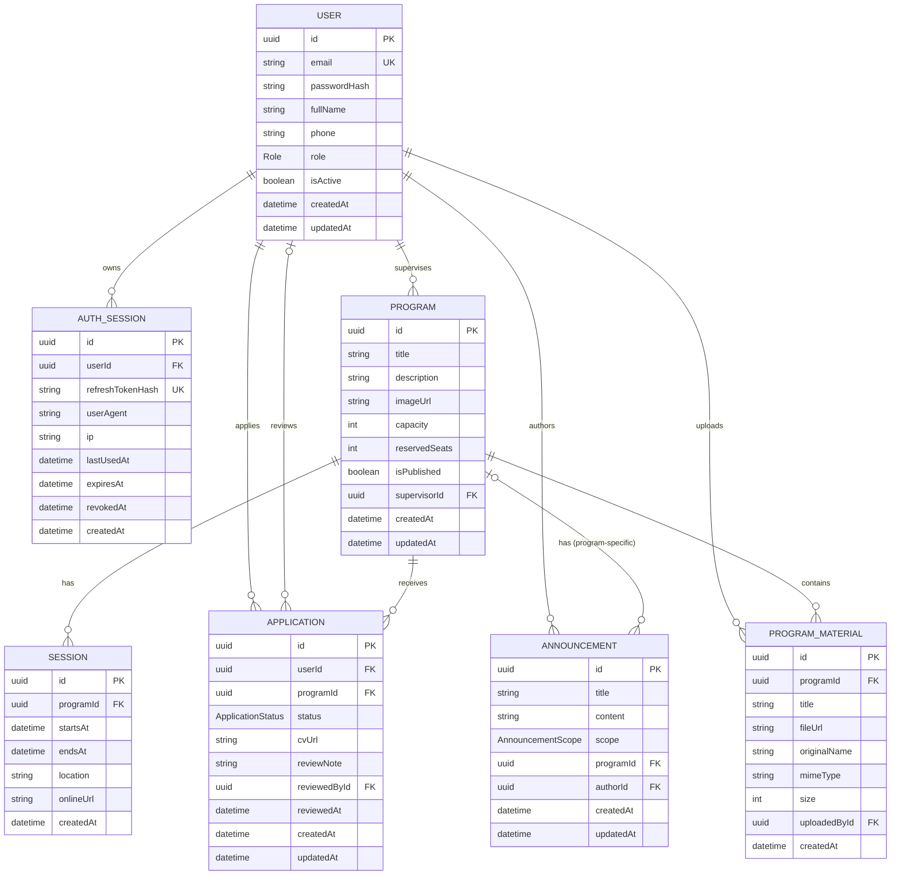

# مخطط قاعدة البيانات — ERD

مخطط الكيانات والعلاقات (Entity Relationship Diagram) لمشروع **سند الشباب**، مبني على `prisma/schema.prisma`.

> الأسماء المنطقية في المخطط تقابل الجداول الفعلية:
> `User → users`، `AuthSession → auth_sessions`، `Program → programs`، `Session → sessions`، `Application → applications`، `Announcement → announcements`، `ProgramMaterial → program_materials`.

## المخطط



## العلاقات

| العلاقة | النوع | الوصف |
|---|---|---|
| `User → Program` | 1 : N | كل برنامج له مشرف واحد، والمشرف قد يدير عدة برامج. |
| `User → Application` | 1 : N | الشاب يقدّم عدة طلبات، وكل طلب يخص شابًا واحدًا. |
| `User → Application (reviewedBy)` | 0..1 : N | الأدمن يراجع عدة طلبات، والطلب قد يكون له مراجع واحد. |
| `User → AuthSession` | 1 : N | جلسات Refresh Token الخاصة بالمستخدم. |
| `User → Announcement` | 1 : N | كل إعلان له كاتب واحد. |
| `User → ProgramMaterial` | 1 : N | كل مادة رفعها مستخدم واحد. |
| `Program → Session` | 1 : N | البرنامج له عدة جلسات. |
| `Program → Application` | 1 : N | البرنامج يستقبل عدة طلبات. |
| `Program → Announcement` | 0..1 : N | الإعلان قد يكون عامًا بلا برنامج، أو خاصًا ببرنامج واحد. |
| `Program → ProgramMaterial` | 1 : N | البرنامج يحتوي عدة مواد. |

## القيود المهمة

| القيد | المكان | الهدف |
|---|---|---|
| `email` فريد | `users.email` | منع تكرار الحساب بنفس البريد. |
| `refreshTokenHash` فريد | `auth_sessions.refreshTokenHash` | ربط Refresh Token بجلسة واحدة. |
| `@@unique([userId, programId])` | `applications` | منع تقديم نفس الشاب على نفس البرنامج أكثر من مرة. |
| `reviewedById` اختياري | `applications.reviewedById` | الطلب قبل المراجعة لا يكون له مراجع. |
| `programId` اختياري | `announcements.programId` | الإعلان العام لا يتبع برنامجًا. |
| `reservedSeats` | `programs.reservedSeats` | عدّاد المقاعد المحجوزة، يُحدَّث ذريًا عند التقديم/الرفض/الإلغاء. |

## القيم الممكنة (Enums)

### `Role`
```text
YOUTH | SUPERVISOR | ADMIN
```

### `ApplicationStatus`
```text
PENDING | ACCEPTED | REJECTED | CANCELED
```

### `AnnouncementScope`
```text
GENERAL | PROGRAM
```

## ملاحظات تصميمية

- `Program.reservedSeats` عدّاد مُشتق من الطلبات، وليس عدًّا مباشرًا في كل قراءة؛ الهدف هو إمكانية الحجز الذري داخل `UPDATE ... WHERE reservedSeats < capacity`.
- `Application` يحمل `userId + programId` مع قيد فريد، لذا التقديم مرة واحدة فقط لكل برنامج.
- `Announcement` يجمع الإعلانات العامة والخاصة في جدول واحد باستخدام `scope` و`programId` الاختياري.
- `AuthSession` منفصل عن `User` لدعم عدة جلسات، وتدوير Refresh Token، وإلغاء جلسة واحدة أو كل الجلسات.
